[한국어](README.md) | **English**

<div align="center">

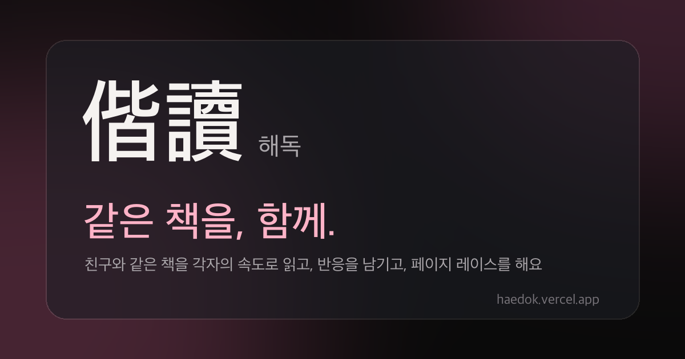

# Same book, together.

**偕** together + **讀** read — read the same book with friends at your own pace, react to paragraphs, and race page by page.

[](https://github.com/10x4hs/haedok/actions/workflows/ci.yml)


[**Open the app →**](https://haedok.vercel.app) · [Intro page](https://haedok.vercel.app/intro) · [PRD](docs/PRD.md) · [Definition of done](GOAL.md) · [Architecture](docs/architecture.md)

<br>

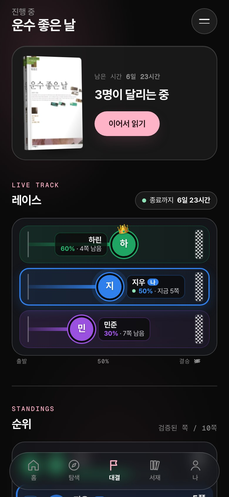

</div>

---

## Why

Even with a friend reading the same book, "where are you up to?" was always a text message away.
Haedok removes that question. Inside the reader you see which page your friend has open and which paragraph they stopped at.
Pages that were merely flipped don't count, and reactions ahead of where you are stay hidden, so you can race without fear of spoilers.

## Features

- **Public-domain classics in a 3D reader** — more than 860 classics (Wikisource, Project Gutenberg) open right in the app. Page turns use StPageFlip, and there's a scroll mode too.
- **Bring your own files** — upload EPUB, PDF or TXT and read it in the same reader. Only the uploader can open it, and DRM-protected files are rejected.
- **A 130-title bookstore with BookTuber videos** — popular new releases link to Aladin e-books, alongside video introductions.
- **One invite code, one race** — open a page race with a single code. Rankings count **only pages the server has verified**.
- **Paragraph reactions with a spoiler guard** — leave an emoji or a one-liner on any paragraph. Reactions on pages you haven't read yet show up only as "🔒 N".
- **Reading together, live** — a room-mate's current position and reactions arrive in real time (WebSocket locally, polling on serverless).
- **Email signup with a 6-digit code** — Resend first, SMTP as fallback. Every attempt is written to `mail_logs` and visible in the admin screens.
- **Installs nowhere, runs everywhere** — a PWA (offline shell, add to home screen) plus an Android TWA. The layout adapts to phone, tablet and desktop, with 30 backgrounds and 12 accent colours to choose from.

| Home · 3D stack | Reader · friend reactions | Race · live standings | Explore · shelves |
|:---:|:---:|:---:|:---:|
| 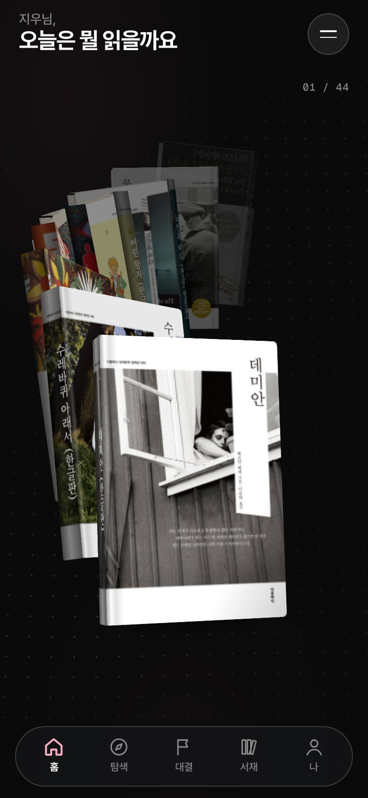 | 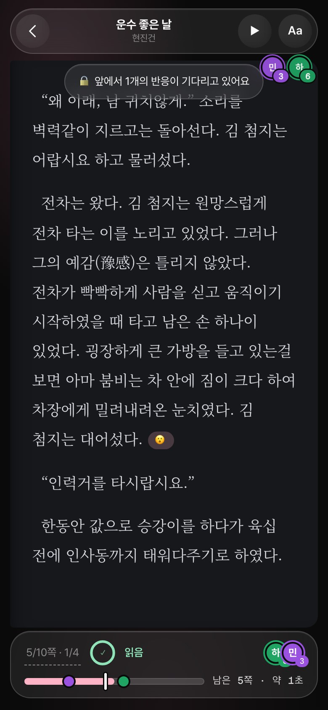 |  | 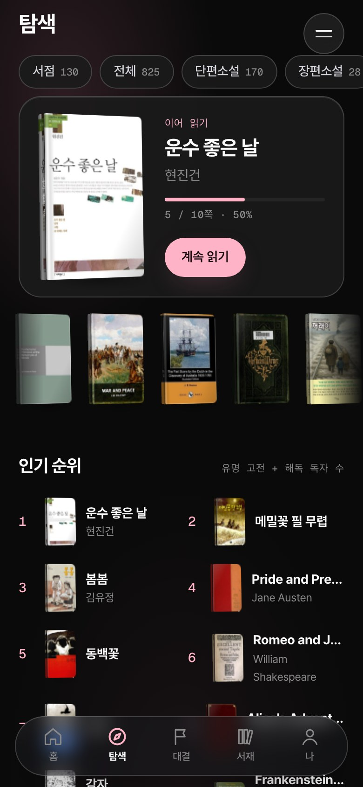 |

## How it flows

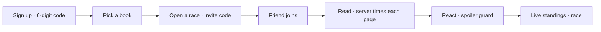

| 1. Landing | 2. Sign up | 3. 6-digit code | 4. Read | 5. React | 6. Race |
|:---:|:---:|:---:|:---:|:---:|:---:|
|  | 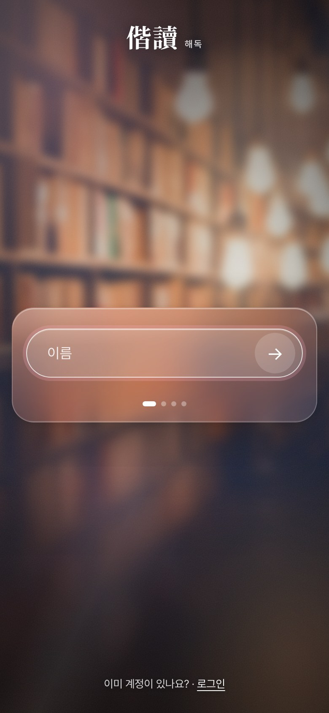 | 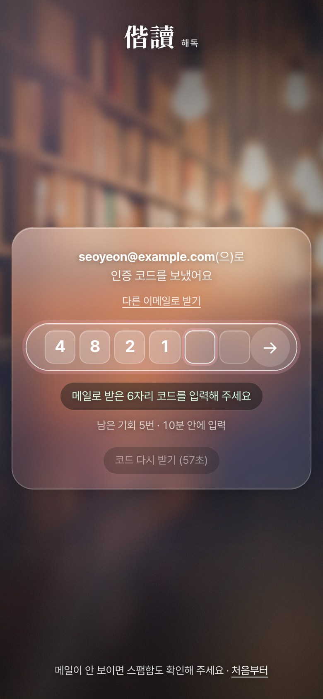 |  |  |  |

**On desktop and tablet** the bottom tab bar becomes a left sidebar and the reader opens two pages like a paper book. The right column always shows where your room-mates are and the reactions on the current page.

| Desktop home | Desktop reader · friend updates fly in |
|:---:|:---:|
|  |  |

<details>
<summary><b>All screens</b></summary>
<br>

| Login | Store | Appearance | Desktop store |
|:---:|:---:|:---:|:---:|
|  |  | 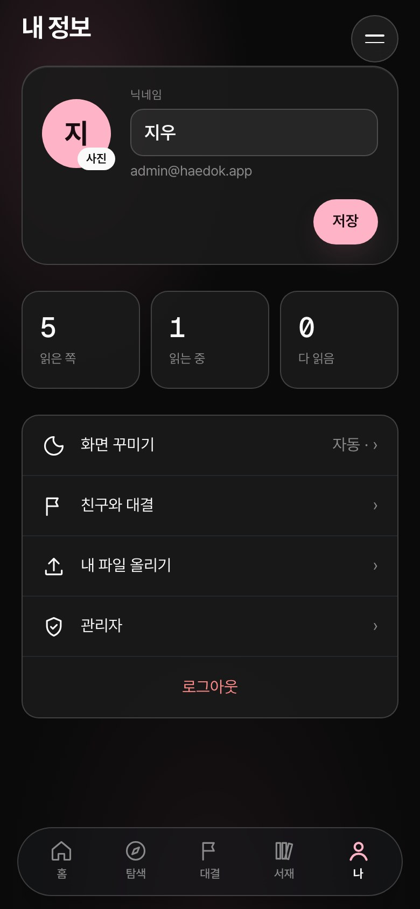 |  |

</details>

## Architecture

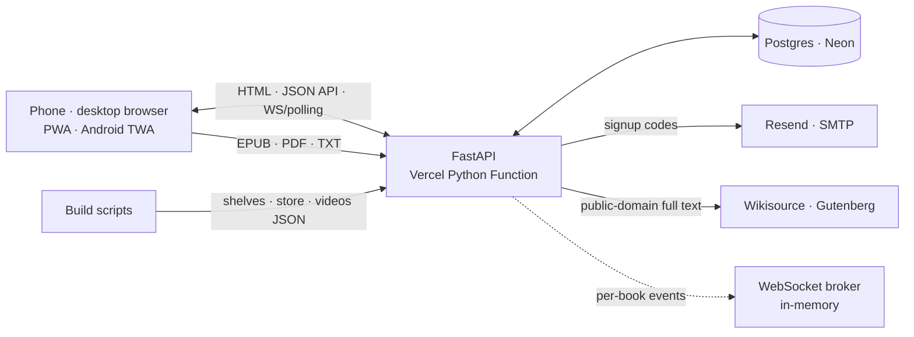

- **Server-rendered, vanilla JS** — no build step. Jinja2 renders the pages; small JS files handle the 3D, the page flip and the live updates.
- **The full-text whitelist is enforced in code** — only sources in `FULLTEXT_SOURCES` (gutendex, wikisource) may store text. Uploads open only for their owner.
- **The server keeps time** — it measures from the moment a page is opened to the "finished" request and credits the page only if the minimum dwell time for its length has passed.
- **Real time** — WebSocket locally (`/api/v1/ws/books/{id}`), 20-second polling on serverless. Socket events never carry reaction text.

Decision records live in [docs/architecture.md](docs/architecture.md).

## Tech stack

| Layer | What we use |
|---|---|
| Server | Python 3.12 · FastAPI · SQLAlchemy 2 (async) · Alembic · pydantic-settings |
| UI | Jinja2 server rendering + vanilla CSS/JS · CSS transform 3D · StPageFlip · View Transitions |
| Data | Postgres (Neon) · SQLite (aiosqlite) for local and tests |
| Mail | Resend API (production) · SMTP 465/587 (local) · every attempt in `mail_logs` |
| Real time | in-memory broker + WebSocket (local) · polling (serverless) |
| Deploy | Vercel Python Function (`api/index.py`) · GitHub Actions CI (tests + migrations on real Postgres) |
| Quality | pytest (zero network, `httpx.MockTransport`) · ruff |

## Quick start

```bash
uv venv .venv && uv pip install -e ".[dev]" --python .venv/bin/python
export DATABASE_URL="sqlite+aiosqlite:///$PWD/scratch-dev.db" DWELL_SCALE=0.06   # demo: minimum dwell time at 6%
.venv/bin/uvicorn app.main:app --port 8011     # http://localhost:8011 (tables are created automatically on SQLite)
.venv/bin/pytest -q && .venv/bin/ruff check .  # tests need no network
```

For Postgres, run `docker compose up -d` and then `alembic upgrade head` once.

### Environment variables

Set them in `.env` or as Vercel environment variables. [`app/core/config.py`](app/core/config.py) is the authoritative list with defaults.

| Variable | Purpose |
|---|---|
| `SECRET_KEY` | Session cookie signing key. **Required in production** |
| `DATABASE_URL` | `postgres://…?sslmode=require` (Neon) or `sqlite+aiosqlite:///…`. Converted to the asyncpg form automatically |
| `COOKIE_SECURE` | `true` on HTTPS |
| `RESEND_API_KEY` · `RESEND_FROM` | Signup code emails. **Use this on Vercel** (SMTP connections drop inside Vercel functions) |
| `SMTP_HOST` · `SMTP_PORT` · `SMTP_USER` · `SMTP_PASSWORD` | SMTP for local or conventional servers (Gmail needs an app password). With neither configured, local runs log the code instead |
| `ADMIN_EMAILS` | Comma-separated emails allowed into `/admin`. Empty means nobody |
| `DWELL_SCALE` | Multiplier on the minimum dwell time (for demos). **Keep 1.0 in production** |
| `MAX_UPLOAD_MB` | Upload limit. 4 on Vercel |
| `ANDROID_PACKAGE` · `ANDROID_CERT_SHA256` | Android TWA signing fingerprint (`/.well-known/assetlinks.json`) |
| `KAKAO_REST_API_KEY` · `NAVER_CLIENT_*` · `GOOGLE_BOOKS_API_KEY` | Metadata search sources. A missing key simply disables that source |
| `SENTRY_DSN` | Sentry error reporting (optional). Off when empty |
| `SITE_URL` | Public base URL (https://…) for canonical, OG, sitemap and invite previews. Falls back to the Vercel URL, then the request host |

## Admin screens

Log in with an account listed in `ADMIN_EMAILS` and `/admin` opens. Everyone else gets a 404.

| Dashboard | Users | Rooms | Mail |
|:---:|:---:|:---:|:---:|
| 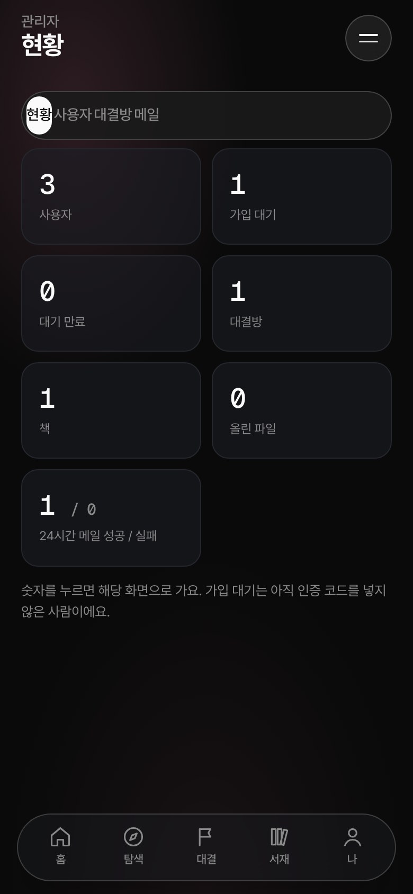 | 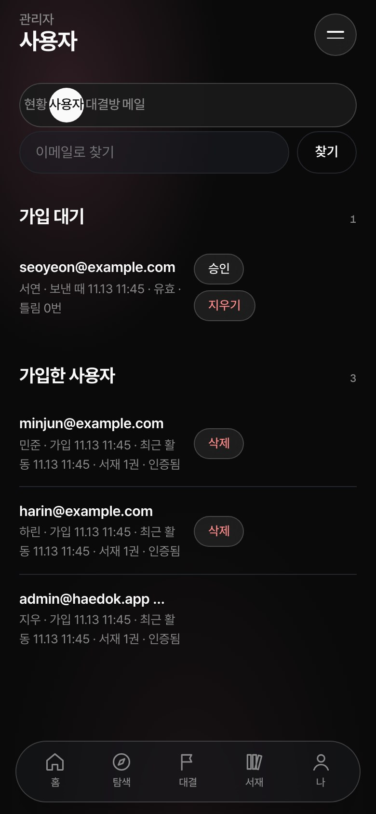 | 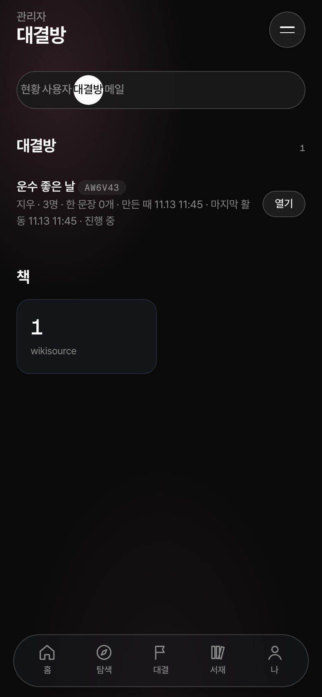 | 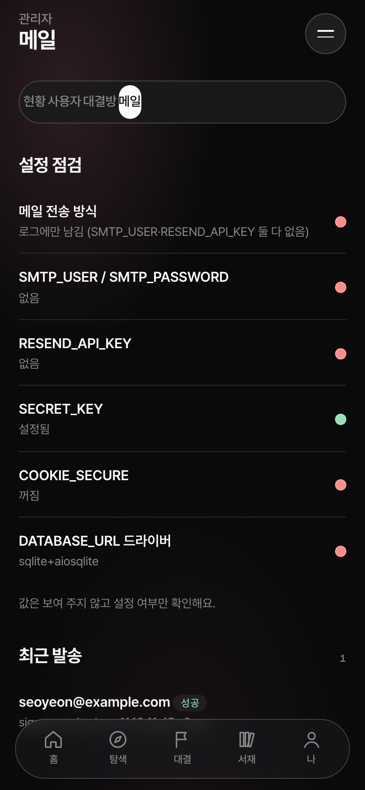 |

- **Dashboard** — users, pending verifications, rooms, books, uploads, and mail success/failure over the last 24 hours.
- **Users** — approve or delete pending signups on the spot; search and delete registered users.
- **Rooms** — open rooms, their books and member counts.
- **Mail** — a configuration check (Resend, SMTP, SECRET_KEY, COOKIE_SECURE, DB driver) and recent deliveries.

## Tests and CI

- `pytest -q` — external APIs are stubbed with `httpx.MockTransport` and the DB is in-memory SQLite, so nothing touches the network.
- `ruff check .` — lint.
- GitHub Actions ([ci.yml](.github/workflows/ci.yml)) runs the tests and, on a real Postgres 16, `alembic upgrade → downgrade base → upgrade` to prove migrations work both ways. The CI badge above shows the current state.

## Three rules we never break

1. **Only lawful text** — the app itself only displays works whose copyright has expired (Wikisource, Project Gutenberg). New releases get metadata and a purchase link; files a user uploads open only for that user.
2. **The server measures reading time** — it starts the clock when a page is opened, and the page counts as read only after the minimum time for its length. Flipping alone never raises a race score.
3. **A spoiler is a bug** — a friend's reactions on pages you haven't read show only as "🔒 N". Real-time events never carry reaction text.

## Roadmap

Phases follow [GOAL.md](GOAL.md).

| Phase | Scope | Status |
|---|---|:---:|
| 0 | FastAPI · SQLAlchemy · Alembic · Docker Compose · CI | ✅ |
| 1 | Five book-source adapters · federated search (partial failure allowed) · full-text chunking | ✅ |
| 2 | Email signup (6-digit code), sessions, CSRF · my library · server-side dwell verification · uploads | ✅ social login · tracker mode ⬜ |
| 3 | Rooms · invite codes · WebSocket broker · paragraph reactions · spoiler guard | ✅ |
| 4 | Page race (server verified) | ✅ one-line review battles · points ledger ⬜ |
| 5 | Teams · weekly league · leaderboard | ⬜ |
| 6 | FCM push · staging deploy | ⬜ |

Also on the list: feeling out the 3D on real iPhones and Androids, and moving production real-time onto a shared broker (Postgres LISTEN/NOTIFY or similar).

## Folder layout

```
app/
  main.py          FastAPI app · lifespan (shared httpx client)
  web.py           page routes (landing · signup/verify · home · explore · reader · races)
  admin.py         /admin (dashboard · users · rooms · mail)
  auth.py          sessions · BCrypt · CSRF · 6-digit signup verification
  api/             JSON API · WebSocket
  services/        dwell time · library · upload parsing · races · reactions (spoiler guard) · mail
  sources/         book-source adapters (gutendex · wikisource · kakao · naver · google_books)
  templates/ static/ data/   Jinja2 · CSS/JS · shelf/store/video JSON
api/index.py       Vercel entry point
migrations/        Alembic
scripts/           build_catalog · build_store · build_videos · fetch_covers · readme_assets
tests/             pytest
docs/              PRD · architecture · images · earlier design drafts (archive)
```

## License and credits

- The source code has no license yet. Until one is added, all rights are reserved by the authors.
- Book text comes from public-domain works on [Wikisource](https://ko.wikisource.org) and [Project Gutenberg](https://www.gutenberg.org) (via the Gutendex API). Page turning by [StPageFlip](https://github.com/Nodlik/StPageFlip), mail by [Resend](https://resend.com), database by [Neon](https://neon.tech).
- Cover images are fetched for demos only and never committed. Aladin e-books can't be opened in the app because of DRM, and the app says so.
- How to regenerate the README images and GIF: [docs/README-assets.md](docs/README-assets.md).
