**한국어** | [English](README.en.md)

<div align="center">


# 같은 책을, 함께.

**偕** 함께 해 + **讀** 읽을 독 — 친구와 같은 책을 각자의 속도로 읽고, 반응을 남기고, 페이지 레이스를 해요.

[](https://github.com/10x4hs/haedok/actions/workflows/ci.yml)


[**앱 열기 →**](https://haedok.vercel.app) · [소개 페이지](https://haedok.vercel.app/intro) · [PRD](docs/PRD.md) · [완료 기준](GOAL.md) · [구조](docs/architecture.md)

<br>


<sub>초대 → 같은 페이지 → 레이스, 14초 요약 · [41초 전체 영상 보기](app/static/demo/haedok-demo.mp4)</sub>

</div>


| 홈 · 3D로 쌓인 책 | 리더 · 친구 반응 | 대결 · 실시간 순위 | 탐색 · 서가 |
|:---:|:---:|:---:|:---:|
| 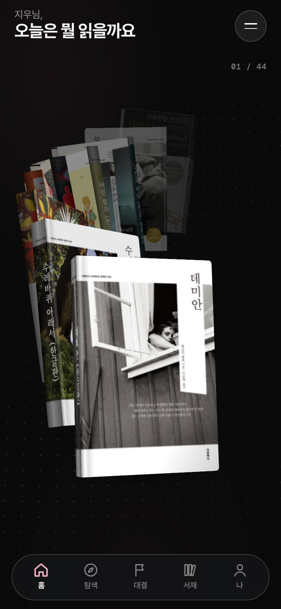 | 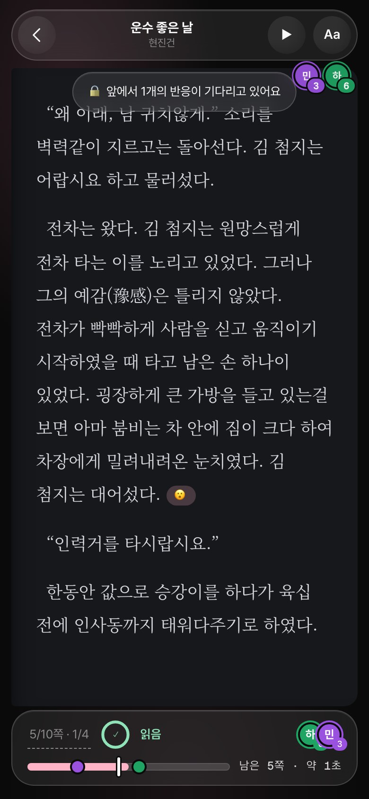 | 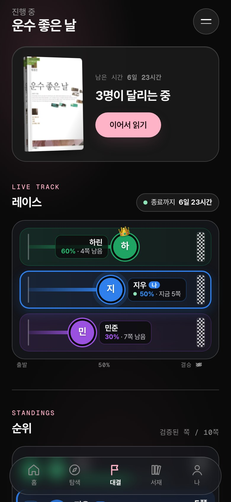 | 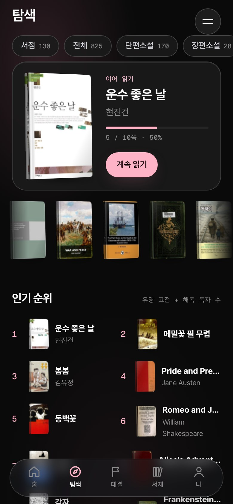 |

## 사용 흐름

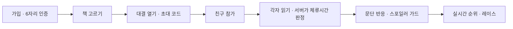

| 1. 랜딩 | 2. 가입 | 3. 6자리 인증 | 4. 읽기 | 5. 반응 | 6. 레이스 |
|:---:|:---:|:---:|:---:|:---:|:---:|
| 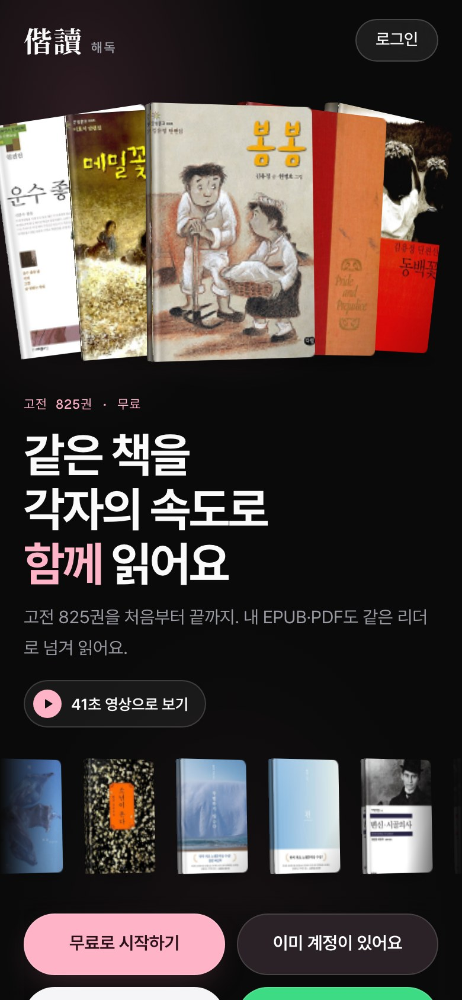 | 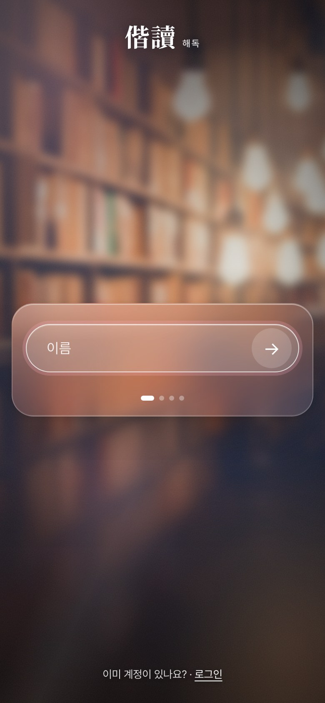 | 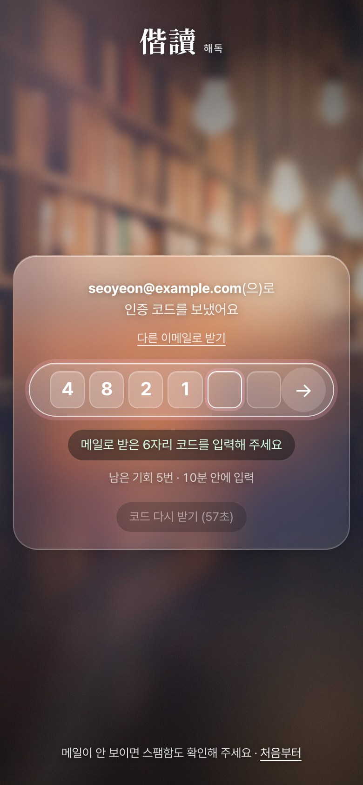 |  |  |  |

**PC·태블릿에서는** 하단 탭 바가 왼쪽 사이드바가 되고, 리더는 종이책처럼 두 쪽을 펼쳐요. 오른쪽 열에는 같이 읽는 친구의 위치와 이 쪽의 반응이 늘 보여요.

| PC 홈 | PC 리더 · 친구 소식이 날아와요 |
|:---:|:---:|
|  |  |

<details>
<summary><b>화면 전체 보기</b></summary>
<br>

| 로그인 | 서점 | 화면 꾸미기 | PC 서점 |
|:---:|:---:|:---:|:---:|
| 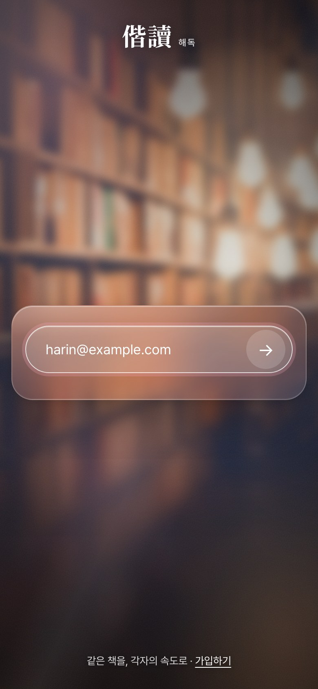 |  | 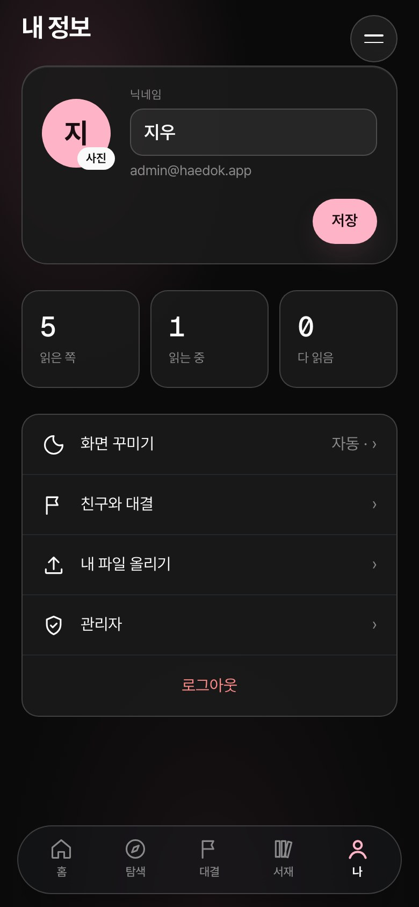 |  |

</details>

## 아키텍처

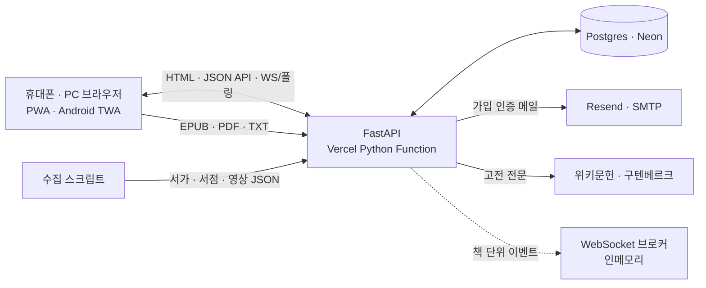

- **서버 렌더링 + 바닐라 JS** — 빌드 단계가 없어요. Jinja2가 화면을 그리고, 3D·책장 넘김·실시간은 작은 JS 파일이 맡아요.
- **본문 화이트리스트는 코드로 강제** — `FULLTEXT_SOURCES`에 있는 소스(gutendex·wikisource)만 본문을 저장해요. 업로드는 올린 사람만 열어요.
- **읽은 시간은 서버가** — 쪽을 펼친 시각부터 "다 읽음" 요청까지를 서버가 재서, 글자 수에 맞는 최소 시간을 넘겨야 인정해요.
- **실시간** — 로컬은 WebSocket(`/api/v1/ws/books/{id}`), 서버리스 배포는 20초 폴링. 소켓 이벤트에는 반응 본문을 싣지 않아요.

더 자세한 결정 기록은 [docs/architecture.md](docs/architecture.md)에 있어요.

## 기술 스택

| 층 | 쓰는 것 |
|---|---|
| 서버 | Python 3.12 · FastAPI · SQLAlchemy 2(async) · Alembic · pydantic-settings |
| 화면 | Jinja2 서버 렌더링 + 바닐라 CSS/JS · CSS transform 3D · StPageFlip · View Transitions |
| 데이터 | Postgres(Neon) · 로컬·테스트는 SQLite(aiosqlite) |
| 메일 | Resend API(배포) · SMTP 465/587(로컬) · 모든 시도는 `mail_logs` |
| 실시간 | 인메모리 브로커 + WebSocket(로컬) · 폴링(서버리스) |
| 배포 | Vercel Python Function(`api/index.py`) · GitHub Actions CI(테스트 + 실제 Postgres 마이그레이션) |
| 품질 | pytest(네트워크 0, `httpx.MockTransport`) · ruff |

## 빠른 시작

```bash
uv venv .venv && uv pip install -e ".[dev]" --python .venv/bin/python
export DATABASE_URL="sqlite+aiosqlite:///$PWD/scratch-dev.db" DWELL_SCALE=0.06   # 시연용: 최소 읽기 시간 6%
.venv/bin/uvicorn app.main:app --port 8011     # http://localhost:8011 (SQLite면 테이블 자동 생성)
.venv/bin/pytest -q && .venv/bin/ruff check .  # 테스트는 네트워크 없이 돌아요
```

Postgres로 돌리려면 `docker compose up -d` 뒤에 `alembic upgrade head`를 한 번 해 주세요.

### 환경 변수

`.env` 파일이나 Vercel 환경 변수로 넣어요. 전체 목록과 기본값은 [`app/core/config.py`](app/core/config.py)가 기준이에요.

| 변수 | 역할 |
|---|---|
| `SECRET_KEY` | 세션 쿠키 서명 키. **배포 필수** |
| `DATABASE_URL` | `postgres://…?sslmode=require`(Neon) 또는 `sqlite+aiosqlite:///…`. asyncpg 형식으로 자동 변환 |
| `COOKIE_SECURE` | HTTPS에서 `true` |
| `RESEND_API_KEY` · `RESEND_FROM` | 가입 인증 메일. **Vercel에서는 이걸 써요** (SMTP는 Vercel 함수에서 끊겨요) |
| `SMTP_HOST` · `SMTP_PORT` · `SMTP_USER` · `SMTP_PASSWORD` | 로컬·일반 서버용 SMTP(Gmail은 앱 비밀번호). 둘 다 없으면 로컬은 코드를 로그에 남겨요 |
| `ADMIN_EMAILS` | `/admin`을 열 수 있는 이메일, 쉼표로 여러 개. 비어 있으면 아무도 못 열어요 |
| `DWELL_SCALE` | 최소 체류시간 배율(시연용). **운영은 1.0** |
| `MAX_UPLOAD_MB` | 업로드 상한. Vercel은 4 |
| `ANDROID_PACKAGE` · `ANDROID_CERT_SHA256` | Android TWA 서명 지문(`/.well-known/assetlinks.json`) |
| `KAKAO_REST_API_KEY` · `NAVER_CLIENT_*` · `GOOGLE_BOOKS_API_KEY` | 메타데이터 검색 소스. 키가 없으면 그 소스만 꺼져요 |
| `SENTRY_DSN` | Sentry 오류 수집(선택). 비우면 꺼져요 |
| `SITE_URL` | 공개 주소(https://…). canonical·OG·사이트맵·초대 미리보기에 써요. 비우면 Vercel URL → 요청 주소 순 |

## 관리자 화면

`ADMIN_EMAILS`에 적힌 계정으로 로그인하면 `/admin`이 열려요. 그 외에는 404예요.

| 현황 | 사용자 | 대결방 | 메일 |
|:---:|:---:|:---:|:---:|
| 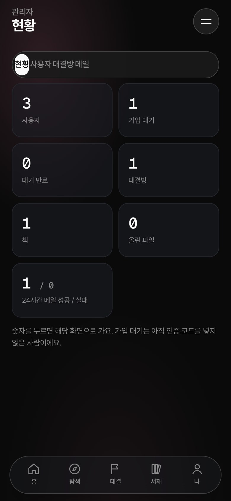 | 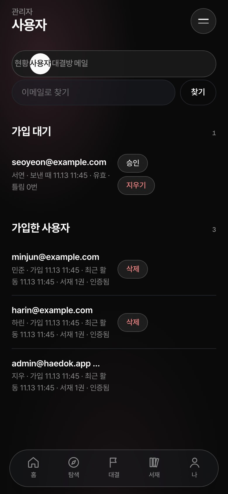 | 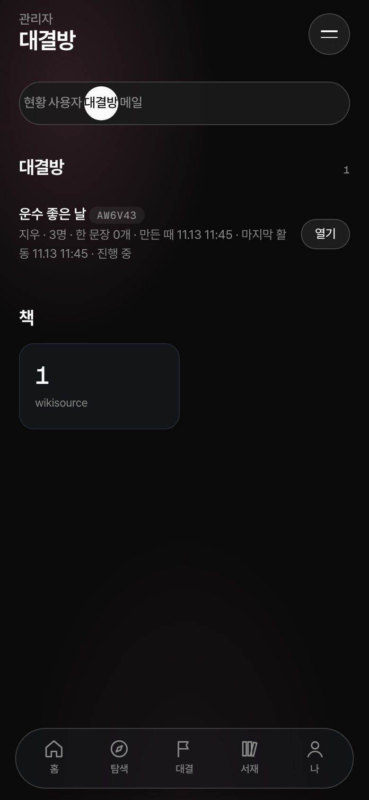 | 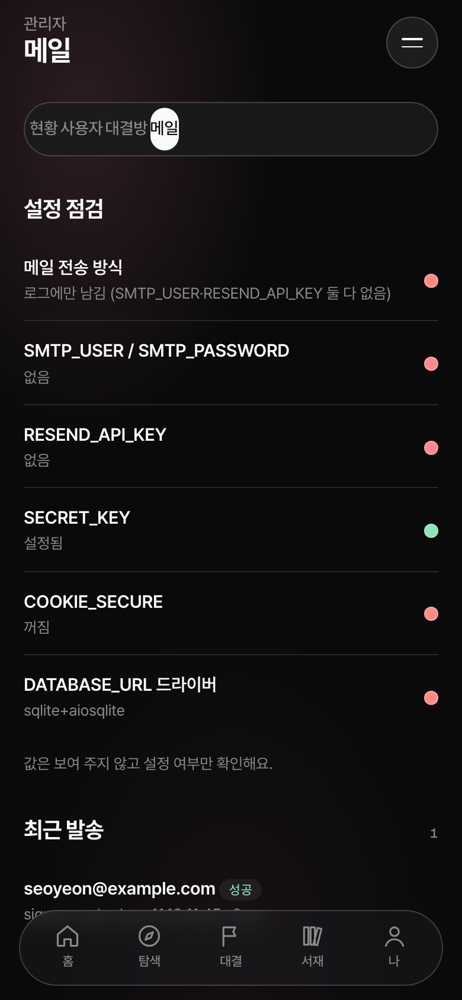 |

- **현황** — 가입자·대기 중인 인증·대결방·책·업로드 수, 최근 24시간 메일 성공/실패.
- **사용자** — 가입 대기 목록을 바로 승인하거나 지우고, 가입한 사용자를 검색·삭제해요.
- **대결방** — 열린 방과 책, 참가자 수.
- **메일** — 설정 점검(Resend·SMTP·SECRET_KEY·COOKIE_SECURE·DB 드라이버)과 최근 발송 기록.

## 테스트 · CI

- `pytest -q` — 외부 API는 `httpx.MockTransport`, DB는 인메모리 SQLite라 네트워크 없이 돌아요.
- `ruff check .` — 린트.
- GitHub Actions([ci.yml](.github/workflows/ci.yml)) — 테스트와 함께 실제 Postgres 16에서 `alembic upgrade → downgrade base → upgrade`를 돌려 마이그레이션이 양방향으로 맞는지 확인해요. 현재 상태는 위 CI 배지에서 봐요.

## 꼭 지키는 규칙 세 가지

1. **본문은 합법적인 것만** — 앱이 직접 보여 주는 본문은 저작권이 끝난 작품(위키문헌·구텐베르크)뿐이에요. 신간은 정보와 구매 링크만 두고, 사용자가 올린 파일은 올린 사람만 열 수 있어요.
2. **읽은 시간은 서버가 잰다** — 쪽을 펼친 시각부터 서버가 재서, 글자 수에 맞는 최소 시간을 채워야 "읽음"이 돼요. 넘기기만 해서는 레이스 점수가 오르지 않아요.
3. **스포일러는 버그** — 내가 아직 읽지 않은 쪽의 친구 반응은 "🔒 N개"로 개수만 보여요. 실시간 알림에도 반응 내용은 싣지 않아요.

## 로드맵

[GOAL.md](GOAL.md)의 단계 기준이에요.

| 단계 | 내용 | 상태 |
|---|---|:---:|
| 0 | FastAPI · SQLAlchemy · Alembic · Docker Compose · CI | ✅ |
| 1 | 도서 소스 어댑터 5종 · 통합 검색(부분 실패 허용) · 전문 청크화 | ✅ |
| 2 | 이메일 가입(6자리 인증)·세션·CSRF · 내 서재 · 서버 체류시간 판정 · 파일 올리기 | ✅ 소셜 로그인·트래커 모드 ⬜ |
| 3 | 대결방 · 초대 코드 · WebSocket 브로커 · 문단 반응 · 스포일러 가드 | ✅ |
| 4 | 페이지 레이스(서버 검증) | ✅ 한줄평 배틀·포인트 원장 ⬜ |
| 5 | 팀 · 주간 리그 · 리더보드 | ⬜ |
| 6 | FCM 푸시 · 스테이징 배포 | ⬜ |

그 밖에 하고 싶은 것: 실제 iPhone·Android에서 3D 손맛 확인, 배포판 실시간을 공유 브로커(Postgres LISTEN/NOTIFY 등)로.

## 폴더 구조

```
app/
  main.py          FastAPI 앱 · lifespan(공용 httpx 클라이언트)
  web.py           화면 라우트 (랜딩 · 가입/인증 · 홈 · 탐색 · 리더 · 대결)
  admin.py         /admin (현황 · 사용자 · 대결방 · 메일)
  auth.py          세션 · BCrypt · CSRF · 6자리 가입 인증
  api/             JSON API · WebSocket
  services/        체류시간 · 서재 · 업로드 파싱 · 대결 · 반응(스포일러 가드) · 메일
  sources/         도서 소스 어댑터 (gutendex · wikisource · kakao · naver · google_books)
  templates/ static/ data/   Jinja2 · CSS/JS · 서가/서점/영상 JSON
api/index.py       Vercel 진입점
migrations/        Alembic
scripts/           build_catalog · build_store · build_videos · fetch_covers · readme_assets
tests/             pytest
docs/              PRD · 구조 · 이미지 · 예전 시안(archive)
```

## 라이선스 · 크레딧

- 소스 코드의 라이선스는 아직 정하지 않았어요. 별도 표기가 있을 때까지 모든 권리는 저작자에게 있어요.
- 본문은 [위키문헌](https://ko.wikisource.org)과 [Project Gutenberg](https://www.gutenberg.org)(Gutendex API)의 퍼블릭 도메인 작품이에요. 책장 넘김은 [StPageFlip](https://github.com/Nodlik/StPageFlip), 메일은 [Resend](https://resend.com), 데이터베이스는 [Neon](https://neon.tech).
- 표지 이미지는 시연용으로만 받고 저장소에 올리지 않아요. 알라딘 전자책은 DRM 때문에 앱에서 열 수 없고, 앱에도 그렇게 안내해요.
- README 이미지와 GIF를 다시 만드는 방법은 [docs/README-assets.md](docs/README-assets.md)에 있어요.
